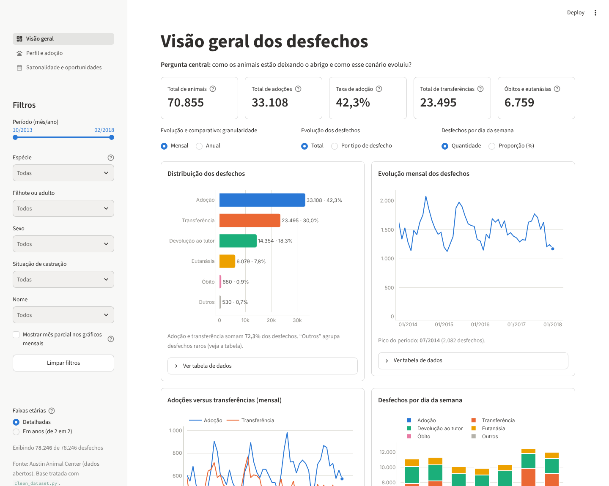
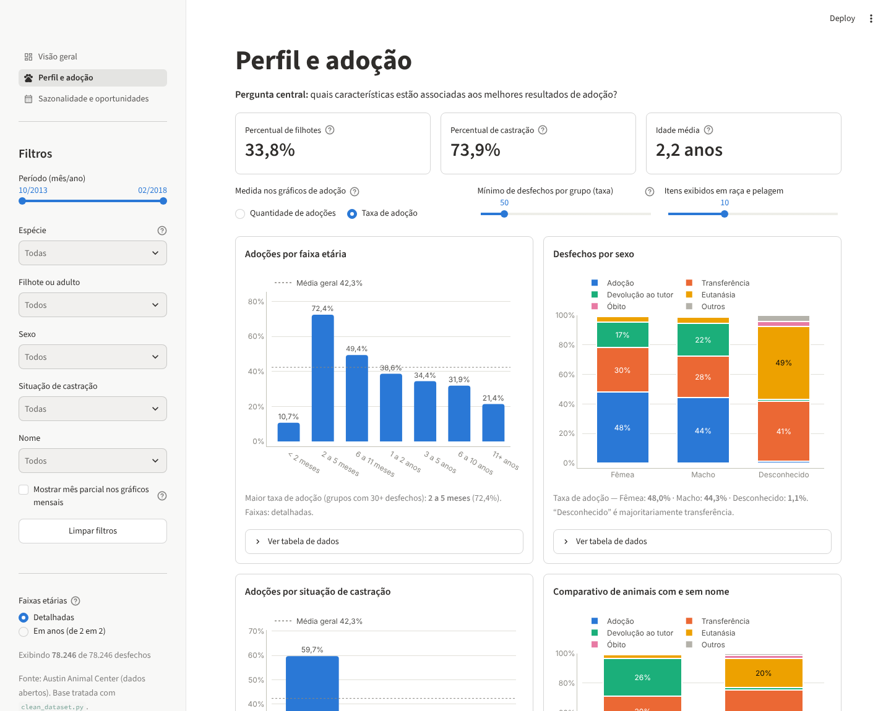
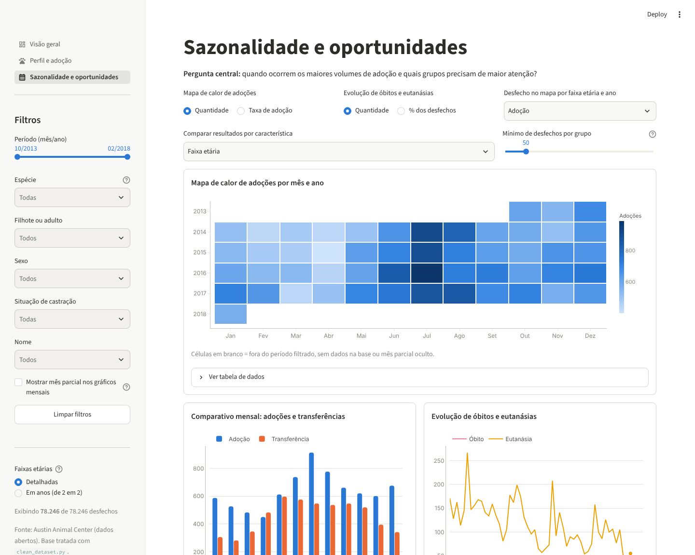

# Para onde vão os animais do abrigo?

Dashboard interativo sobre os desfechos de animais no **Austin Animal Center** (Texas, EUA). O projeto parte de uma base pública bruta, faz a limpeza e a validação dos dados e entrega um painel em três páginas para responder perguntas de negócio sobre adoção, perfil dos animais e sazonalidade.

| | |
|---|---|
| **Dados** | 78.246 desfechos de 70.855 animais (cães, gatos, outros animais, aves e animais de fazenda) |
| **Período** | outubro de 2013 a 1º de fevereiro de 2018 |
| **Tecnologias** | Python, Streamlit, Plotly, pandas |
| **Idioma do painel** | Português (Brasil), com modo claro e escuro automáticos |



## Índice

- [Para onde vão os animais do abrigo?](#para-onde-vão-os-animais-do-abrigo)
  - [Índice](#índice)
  - [Instalação rápida](#instalação-rápida)
  - [O que o dashboard mostra](#o-que-o-dashboard-mostra)
    - [Página 1: Visão geral](#página-1-visão-geral)
    - [Página 2: Perfil e adoção](#página-2-perfil-e-adoção)
    - [Página 3: Sazonalidade e oportunidades](#página-3-sazonalidade-e-oportunidades)
  - [Principais insights](#principais-insights)
    - [Panorama](#panorama)
    - [Quando as adoções acontecem](#quando-as-adoções-acontecem)
    - [Perfil dos animais](#perfil-dos-animais)
    - [Onde o abrigo precisa de mais atenção](#onde-o-abrigo-precisa-de-mais-atenção)
  - [Estrutura do projeto](#estrutura-do-projeto)
  - [Dados e limpeza](#dados-e-limpeza)
  - [Como interpretar os resultados](#como-interpretar-os-resultados)
  - [Testes](#testes)

## Instalação rápida

Pré-requisito: **Python 3.10 ou superior** instalado.

Abra um terminal **dentro da pasta do projeto** (a que contém o `app.py`) e rode:

**Windows (PowerShell ou Git Bash)**
```bash
python -m venv .venv
.venv\Scripts\activate          # no Git Bash use: source .venv/Scripts/activate
pip install -r requirements.txt
streamlit run app.py
```

**macOS ou Linux**
```bash
python3 -m venv .venv
source .venv/bin/activate
pip install -r requirements.txt
streamlit run app.py
```

## O que o dashboard mostra

Os filtros da barra lateral valem para as três páginas: **período**, **espécie**, filhote ou adulto, sexo, situação de castração e nome. Todo gráfico tem uma tabela com os dados logo abaixo, e os números mudam em tempo real conforme os filtros.

### Página 1: Visão geral
Pergunta central: *como os animais estão deixando o abrigo e como esse cenário evoluiu?*

- 5 indicadores: total de animais, adoções, taxa de adoção, transferências, óbitos e eutanásias
- distribuição dos desfechos
- evolução mensal ou anual, no total ou por tipo de desfecho
- adoções versus transferências
- desfechos por dia da semana
- comparativo de desfechos entre espécies

### Página 2: Perfil e adoção
Pergunta central: *quais características estão associadas aos melhores resultados de adoção?*

- percentual de filhotes, percentual de castração e idade média
- adoção por faixa etária, sexo, situação de castração, com ou sem nome, raça e pelagem
- alternância entre **quantidade** de adoções e **taxa** de adoção, com controle de tamanho mínimo de grupo



### Página 3: Sazonalidade e oportunidades
Pergunta central: *quando ocorrem os maiores volumes de adoção e quais grupos precisam de maior atenção?*

- mapa de calor de adoções por mês e ano
- média de adoções e transferências por mês do ano
- evolução de óbitos e eutanásias
- mapa de calor por faixa etária e ano
- ranking de grupos com maior incidência de óbitos e eutanásias, por qualquer característica



## Principais insights

Todos os números abaixo vêm da base limpa e podem ser reproduzidos com os filtros do painel. Quando uma conclusão depende da espécie, ela é separada em **cães** e **gatos**, porque os dois perfis são muito diferentes. Veja também [como interpretar os resultados](#como-interpretar-os-resultados).

### Panorama

- **Quatro em cada dez saídas são adoções.** A taxa geral é de 42,3%, seguida por transferências (30,0%), devoluções ao tutor (18,3%), eutanásias (7,8%) e óbitos (0,9%).
- **Cada espécie tem um destino típico.** Entre os cães, 45,3% são adotados e 29,1% voltam ao tutor. Entre os gatos, 43,3% são adotados, mas 45,3% são transferidos e só 4,9% voltam ao tutor. Já nos outros animais, sobretudo silvestres, 71,5% dos desfechos são eutanásias.
- **A taxa de adoção subiu enquanto o volume ficou estável.** Nos anos completos, o abrigo registrou entre 17,6 mil e 18,7 mil desfechos por ano, mas a taxa de adoção passou de 38,1% em 2014 para 45,7% em 2016 e 45,8% em 2017. 2013 (só de outubro a dezembro) e 2018 (só janeiro) são parciais e ficam fora dessa comparação.

### Quando as adoções acontecem

- **O fim de semana concentra as adoções.** Sábado tem taxa de adoção de 56,8% e domingo de 52,6%, contra 35% a 37% de segunda a sexta. Os dois dias respondem por 41% de todas as adoções.
- **Os gatos têm uma temporada forte, os cães não.** A média de adoções de gatos vai de cerca de 102 por mês em abril a 478 em julho, quase cinco vezes mais. Nos cães o movimento é estável, entre 338 por mês (novembro) e 430 (julho). O padrão dos gatos provavelmente acompanha a época de nascimento de filhotes.
- **Para o abrigo, julho é o mês de pico.** Somando todas as espécies, a média passa de 451 adoções por mês em abril para 914 em julho.

### Perfil dos animais

- **Filhotes de 2 a 5 meses são os mais adotados.** A taxa de adoção é de 76,7% nos gatos e 66,7% nos cães dessa faixa. Depois disso ela cai com a idade nos cães, até 16,2% a partir dos 11 anos.
- **Gatinhos com menos de 2 meses quase não são adotados direto.** Só 6,5% são adotados e 84,6% são transferidos, todos para organizações parceiras do abrigo. Nos gatos adultos (1 a 2 anos), a transferência também é o destino mais comum (57,7%).
- **Quase todo animal adotado está castrado.** São 94,1% das adoções de gatos e 97,3% das de cães. Isso provavelmente reflete o procedimento do abrigo antes da saída, e não uma preferência de quem adota. Entre os animais com 1 ano ou mais, a taxa de adoção dos castrados é de 43,0% nos gatos e 47,4% nos cães, contra 1,2% e 5,8% dos não castrados.
- **O nome pesa muito para os gatos, e quase nada para os cães.** Gatos com nome têm 63,7% de adoção, contra 16,8% dos sem nome. Entre os cães a diferença some (45,0% contra 46,8%). Entre os gatos com 1 ano ou mais, a diferença persiste: 47,2% contra 4,0%.
- **Fêmeas são um pouco mais adotadas que machos**, com diferença maior nos cães (48,2% contra 43,3%) do que nos gatos (48,1% contra 46,6%).
- **A raça importa entre os cães.** Entre as raças com 500 ou mais desfechos, Australian Cattle Dog (54,4%), Border Collie (53,0%) e Catahoula (52,7%) lideram a adoção. Pit Bull, a raça mais numerosa (6.738 desfechos), tem taxa de 36,4% e 35,6% de devoluções ao tutor, e o Husky Siberiano tem a maior taxa de devolução ao tutor entre elas (44,4%).
- **Entre os gatos, a pelagem tem efeito pequeno.** Torbie (49,5%), calico (47,1%) e creme (45,6%) ficam acima da média, mas as diferenças são modestas.

### Onde o abrigo precisa de mais atenção

- **A incidência de eutanásia e óbito cresce com a idade.** Nos gatos, vai de 2,6% (2 a 5 meses) para 22,1% (11 anos ou mais). Nos cães, de 1,5% para 12,4%. Os gatos com menos de 2 meses também têm um pico (8,5%).
- **Os motivos de eutanásia são diferentes por espécie.** Nos gatos, o principal é "sofrimento" (1.303 casos). Nos cães, "sofrimento" (684) e "agressividade" (501) lideram. Nos outros animais, 2.271 dos 2.417 casos de "risco de raiva" de toda a base, o que explica a taxa de 71,5%.
- **Dica para apresentações:** para falar de adoção de animais de estimação, filtre **Cães e Gatos** na barra lateral. Os silvestres puxam para cima a taxa de eutanásia e distorcem os grupos de sexo desconhecido.

## Estrutura do projeto

```
app.py                       ponto de entrada: tema, filtros globais e navegação
core/
    data.py                  leitura da base, traduções para português e colunas derivadas
    filters.py               barra lateral de filtros (valem para as 3 páginas)
    metrics.py               KPIs e agregações
    charts.py                gráficos Plotly (paleta validada, modos claro e escuro)
    ui.py                    formatação pt-BR, cartões de gráfico e indicadores
views/
    visao_geral.py           página 1
    perfil_adocao.py         página 2
    sazonalidade.py          página 3
data/
    aac_shelter_outcomes_clean.csv    base limpa (78.246 desfechos)
scripts/
    clean_dataset.py         limpeza da base bruta, gera o CSV acima
docs/
    data_quality_report.md   relatório do que foi encontrado e corrigido
    img/                     capturas de tela usadas neste README
tests/
    test_app.py              testes automáticos
.streamlit/config.toml       temas claro e escuro
requirements.txt             dependências
```

## Dados e limpeza

**Fonte:** dados abertos do Austin Animal Center, com 12 colunas por desfecho (espécie, raça, cor, sexo, nascimento, data e tipo de desfecho, entre outras).

**Tratamento:** o script `scripts/clean_dataset.py` lê o arquivo bruto, corrige e valida os dados, e gera o CSV limpo mais um relatório. Ele falha se qualquer validação final não passar. Principais correções:

- 10 linhas duplicadas removidas
- 8 datas de nascimento ausentes ou posteriores ao desfecho: a linha é mantida, e idade e faixa etária ficam como desconhecidas
- nomes padronizados (o `*` do AAC, que indica nome dado pelo abrigo, vira uma coluna própria) e nomes placeholder tratados
- 4.063 desfechos com horário exatamente 00:00 ou 09:00 marcados como pouco confiáveis para análise por hora
- sexo e castração recalculados a partir de uma única coluna de origem, mantendo "desconhecido" como desconhecido
- raças e cores separadas em colunas próprias (raça 1 e 2, cor-base e padrão), com indicador de mistura
- faixas etárias calculadas pela idade exata em dias, e não pelo rótulo arredondado

O relatório completo, com a contagem de linhas afetadas em cada correção, está em [`docs/data_quality_report.md`](docs/data_quality_report.md).

Para refazer a base a partir do arquivo bruto:

```bash
python scripts/clean_dataset.py aac_shelter_outcomes.csv -o data/aac_shelter_outcomes_clean.csv --report docs/data_quality_report.md
```

## Como interpretar os resultados

- **Cada linha é um desfecho, não um animal.** O mesmo animal pode sair do abrigo mais de uma vez. Por isso o painel mostra 70.855 animais, mas 78.246 desfechos, e a **taxa de adoção** é calculada como adoções divididas por desfechos.
- **Associação não é causalidade.** Idade, castração, nome e raça se misturam. Por exemplo, filhotes não são castrados, e muitos animais sem nome saem do abrigo logo na entrada.
- **Grupos pequenos têm taxas instáveis.** Use o controle de tamanho mínimo nos rankings de raça e pelagem.
- **Períodos parciais.** 2013 cobre só outubro a dezembro e fevereiro de 2018 tem apenas o primeiro dia. Esses períodos são marcados com `*`, o mês parcial fica oculto nos gráficos mensais (há uma opção na barra lateral para exibi-lo) e a média por mês do ano usa só meses completos. Os indicadores sempre incluem todos os registros.
- **Filhote** significa até 182 dias de idade (cerca de 6 meses), a mesma regra para todas as espécies. Em cães, parte dos filhotes de 6 a 12 meses conta como adulto.
- **Espécies não são comparáveis sem cuidado.** O sexo é desconhecido em 85% dos outros animais e em 0,5% dos cães, e as transferências têm pesos muito diferentes entre espécies.
- **Alta incidência de eutanásia não é um julgamento do abrigo.** Ela pode refletir a condição do animal na chegada, como filhotes sem mãe, animais idosos ou doentes, e o risco de raiva em silvestres.

## Testes

```bash
pip install pytest
pytest -q
```

Os testes conferem a integridade da base (contagem de linhas e de animais por espécie), verificam que cada página roda sem erros, testam o filtro de espécie em vários cenários e checam que os totais exibidos batem com a base.